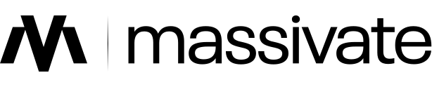

  <a href="https://www.massivate.com">
    <picture>
      <source media="(prefers-color-scheme: dark)" srcset="./assets/massivate-logo-dark.svg">
      
    </picture>
  </a>

**We run your marketing and build what it runs on.**

Massivate is a growth studio in Belgrade. One team handles brand, content, ads, websites, product and software as a monthly partnership, working with teams across Europe and Türkiye.

This organization holds the build side of that work: the websites and products we ship for clients, the software we run ourselves, and the internal tools our team works with every day.

### What we build

**Web & Product.** Websites, landing pages, conversion work, UI/UX and design systems.

**Software & IT.** Custom software, integrations, automation, infrastructure, hosting and maintenance.

### How we work

We are a small team. The people who plan a campaign also build the page and set up its tracking. Client repositories stay private.

### Get in touch

[massivate.com](https://www.massivate.com) · [hello@massivate.com](mailto:hello@massivate.com) · [LinkedIn](https://www.linkedin.com/company/massivate)
